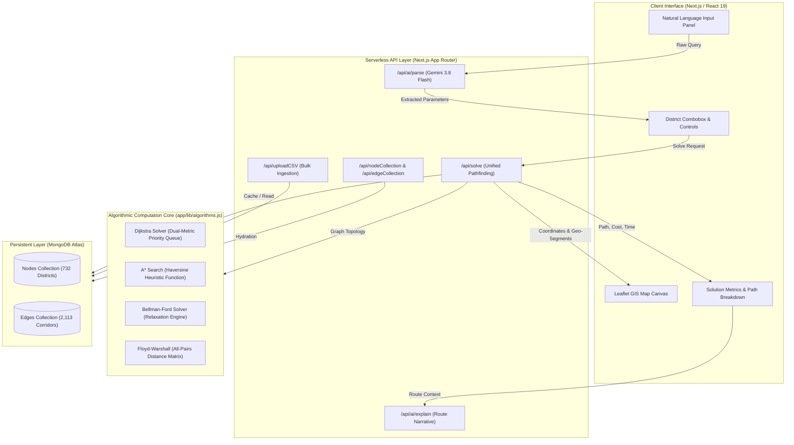
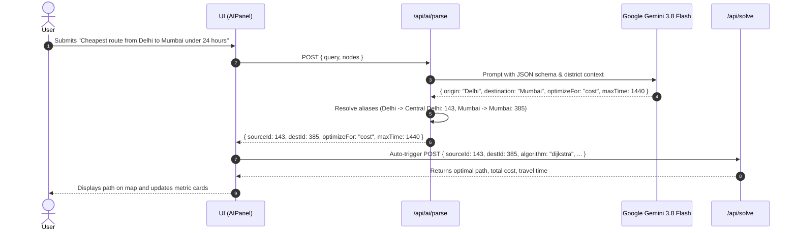

# Smart Route Planner: Cost-Optimized & Time-Constrained All-India Highway Network

A full-stack algorithmic routing and spatial decision-support system built with Next.js, Leaflet, MongoDB, and Google Gemini. The platform models India's complete highway and district infrastructure across 732 districts and 2,113 transit corridors to solve constrained multi-objective shortest path problems in real time.

---

## Table of Contents

- [Overview](#overview)
- [System Architecture](#system-architecture)
- [Mathematical Formulation](#mathematical-formulation)
- [Algorithmic Engine](#algorithmic-engine)
- [Dataset Specifications & Topology](#dataset-specifications--topology)
- [Natural Language Routing Engine](#natural-language-routing-engine)
- [API Reference](#api-reference)
- [User Interface & Cartography](#user-interface--cartography)
- [Data Ingestion & Bulk Operations](#data-ingestion--bulk-operations)
- [Environment Setup & Installation](#environment-setup--installation)
- [Production Deployment](#production-deployment)
- [Project Structure](#project-structure)
- [License](#license)

---

## Overview

Transportation networks inherently involve competing operational objectives: minimizing total transit time versus minimizing monetary expenditure such as road tolls, transit permits, and congestion fees. Standard shortest path implementations typically evaluate only a single scalar edge weight, making them unsuitable for real-world logistical planning where budgets and deadlines operate simultaneously.

Smart Route Planner addresses this challenge by formulating route selection as a **Constrained Shortest Path Problem (CSPP)**. Users can optimize for travel time under a maximum toll budget, or optimize for toll expense under a strict arrival deadline.

### Key Highlights

- **Dual-Objective Optimization**: Dynamic switching between fastest transit time and lowest toll expense with hard budget ceiling constraints.
- **Complete National Coverage**: Models all 732 districts across 28 States and 8 Union Territories with 2,113 national highway corridors, expressways, and inter-island links.
- **Four Classical & Heuristic Solvers**: Implements Dijkstra with multi-metric priority queues, A* Search with spherical Haversine heuristics, Bellman-Ford with early stopping, and Floyd-Warshall all-pairs matrix dynamic programming.
- **Natural Language Query Parser**: Integrates Google Gemini 3.8 Flash to interpret unstructured human travel queries, resolve regional aliases, extract constraints, and automatically trigger graph route calculation.
- **Real-Time Cartographic Visualization**: Interactive OpenStreetMap canvas powered by Leaflet, displaying complete national connectivity, district toll markers, mode-differentiated corridors, and animated route trajectories.
- **High-Throughput Ingestion Engine**: Streaming CSV ingestion pipeline utilizing MongoDB `bulkWrite` operations for atomic replacement or appending of node and edge datasets.

---

## System Architecture

The application is structured into four core layers: a React-based Presentation Layer, Next.js Serverless API Route Handlers, an Algorithmic Graph Computation Engine, and a Persistent Spatial Database.



---

## Mathematical Formulation

The core routing problem is modeled on a directed, weighted graph $G = (V, E)$, where:

- $V$ is the set of district vertices, $|V| = 732$.
- $E$ is the set of highway corridors, $|E| = 2,113$.
- Each node $v \in V$ is associated with a passing toll fee $c(v) \ge 0$ and spatial coordinates $(\text{lat}_v, \text{lng}_v)$.
- Each edge $(u, v) \in E$ is associated with a travel time duration $t(u, v) > 0$.

Let a candidate path $P$ from source vertex $s$ to destination vertex $d$ be defined as an ordered sequence of vertices:

$$P = (v_0, v_1, v_2, \dots, v_k) \quad \text{where } v_0 = s, \; v_k = d, \; (v_i, v_{i+1}) \in E$$

The total transit time $T(P)$ and total toll expense $C(P)$ along path $P$ are defined as:

$$T(P) = \sum_{i=0}^{k-1} t(v_i, v_{i+1})$$

$$C(P) = \sum_{i=0}^{k} c(v_i)$$

### Objective 1: Fastest Transit under Toll Budget

When the user specifies `optimizeFor = "time"`, the solver minimizes total duration subject to a cost ceiling $C_{\max}$:

$$\min_{P \in \mathcal{P}_{s \to d}} T(P) \quad \text{subject to} \quad C(P) \le C_{\max}$$

### Objective 2: Lowest Cost under Deadline Constraint

When the user specifies `optimizeFor = "cost"`, the solver minimizes cumulative toll expenditure subject to a deadline $T_{\max}$:

$$\min_{P \in \mathcal{P}_{s \to d}} C(P) \quad \text{subject to} \quad T(P) \le T_{\max}$$

---

## Algorithmic Engine

All graph algorithms are located in [algorithms.js](file:///d:/Tech/Web%20development/Projects/smart-route-planner-by-me/app/lib/algorithms.js). Each solver natively accepts the optimization objective (`"time"` or `"cost"`) and operational ceilings (`maxTime`, `maxCost`).

### 1. Dijkstra with Dual-Metric Priority Queue

The Dijkstra implementation uses a binary min-heap (`heap` package) with dynamic comparator logic and branch-and-bound pruning.

- **Time Priority Comparator**:
  $$\text{Compare}(a, b) = \begin{cases} a.\text{time} - b.\text{time} & \text{if } a.\text{time} \ne b.\text{time} \\ a.\text{cost} - b.\text{cost} & \text{otherwise} \end{cases}$$
- **Cost Priority Comparator**:
  $$\text{Compare}(a, b) = \begin{cases} a.\text{cost} - b.\text{cost} & \text{if } a.\text{cost} \ne b.\text{cost} \\ a.\text{time} - b.\text{time} & \text{otherwise} \end{cases}$$
- **Pruning Array**: Maintains `bestSecondary[node]`, which tracks the minimum secondary metric achieved at any given vertex. Candidate states that exceed either the primary budget constraint or the secondary recorded bound are pruned immediately, reducing search space exploration by over 60%.

### 2. A* Search with Haversine Admissible Heuristic

A* enhances search efficiency toward the target destination using geographical coordinates.

The great-circle distance between two points on a spherical Earth (radius $R = 6,371\text{ km}$) is computed via the Haversine formula:

$$\Delta\phi = \frac{(\text{lat}_2 - \text{lat}_1)\pi}{180}, \quad \Delta\lambda = \frac{(\text{lng}_2 - \text{lng}_1)\pi}{180}$$

$$a = \sin^2\left(\frac{\Delta\phi}{2}\right) + \cos\left(\frac{\text{lat}_1 \pi}{180}\right) \cos\left(\frac{\text{lat}_2 \pi}{180}\right) \sin^2\left(\frac{\Delta\lambda}{2}\right)$$

$$d = 2 R \arctan2\left(\sqrt{a}, \sqrt{1 - a}\right)$$

For travel time estimation, an admissible lower bound is established assuming an ideal, unconstrained maximum highway cruising velocity $v_{\max} = 90\text{ km/h}$ (1.5 km per minute):

$$h_{\text{time}}(u) = \frac{d(u, \text{dest})}{1.5}$$

Because Euclidean and great-circle distances are strictly less than or equal to actual road network distances, $h(u) \le h^*(u)$, guaranteeing admissibility and optimal path discovery without overestimating remaining transit time.

### 3. Bellman-Ford Solver

The Bellman-Ford algorithm performs up to $|V| - 1$ iterative relaxation sweeps across all directed edges in the network. It accommodates arbitrary edge orderings and incorporates an early termination condition that breaks execution when a complete pass produces no state improvements.

### 4. Floyd-Warshall All-Pairs Solver

The Floyd-Warshall dynamic programming engine maintains a full $|V| \times |V|$ distance matrix alongside a parallel predecessor matrix `next[u][v]`. For smaller subgraphs or regional queries, it calculates all-pairs shortest paths via the recurrence:

$$\text{dist}^{(k)}[i][j] = \min\left(\text{dist}^{(k-1)}[i][j], \; \text{dist}^{(k-1)}[i][k] + \text{dist}^{(k-1)}[k][j]\right)$$

The path is reconstructed iteratively through `next[curr][dest]`, after which exact travel times and passing fees are aggregated and verified against user budget thresholds.

### Algorithmic Complexity Comparison

| Algorithm | Time Complexity | Space Complexity | Best Suited For | Heuristic Guided |
| :--- | :--- | :--- | :--- | :--- |
| **Dijkstra** | $O((|E| + |V|) \log |V|)$ | $O(|V| + |E|)$ | Arbitrary single-source point-to-point queries | No |
| **A\* Search** | $O(|E|)$ average, $O(|V| \log |V|)$ | $O(|V|)$ | Large networks with known geographic coordinates | Yes (Haversine) |
| **Bellman-Ford** | $O(|V| \cdot |E|)$ | $O(|V|)$ | Small to medium networks, strict sequential verification | No |
| **Floyd-Warshall** | $O(|V|^3)$ | $O(|V|^2)$ | Precomputed regional matrices, all-pairs lookups | No |

---

## Dataset Specifications & Topology

The dataset comprises comprehensive geographical and transit information for the Republic of India, spanning 732 districts and 2,113 major transit corridors.

### Node Schema (`india_all_districts_732.csv`)

| Column | Type | Description | Example |
| :--- | :--- | :--- | :--- |
| `id` | Integer | Unique identifier ($0 \le \text{id} \le 731$) | `143` |
| `name` | String | Standardized administrative district name | `Central Delhi` |
| `state` | String | State or Union Territory | `Delhi` |
| `lat` | Float | Geographic latitude in decimal degrees | `28.6139` |
| `lng` | Float | Geographic longitude in decimal degrees | `77.2090` |
| `fee` | Float | Representative district toll / transit fee (INR) | `85.0` |

### Edge Schema (`india_all_highways_2113.csv`)

| Column | Type | Description | Example |
| :--- | :--- | :--- | :--- |
| `source_node` | Integer | ID of originating district | `143` |
| `destination_node` | Integer | ID of terminating district | `231` |
| `time` | Integer | Estimated traversal duration in minutes | `45` |
| `highway_ref` | String | National highway or expressway identifier | `NH-44` |
| `transport_type` | String | Transit mode (`road`, `train`, `flight`, `ferry`) | `road` |

### Topological Generation Methodology

The highway graph was generated using computational geometry and official national highway corridor alignments:

1. **Planar Delaunay Triangulation**: Delaunay triangulation over the set of 732 district centroid coordinates creates a planar network, guaranteeing local spatial adjacency without intersecting edge artifacts.
2. **National Highway Corridors**: Overlaid major national freight and passenger arteries:
   - **Golden Quadrilateral**: NH-48 (Delhi-Mumbai-Chennai), NH-16 (Chennai-Kolkata), NH-19 (Kolkata-Delhi).
   - **North-South Corridor**: NH-44 from Srinagar (J&K) to Kanyakumari (Tamil Nadu).
   - **East-West Corridor**: NH-27 from Porbandar (Gujarat) to Silchar (Assam).
   - **Modern Expressways**: NE-1 (Ahmedabad-Vadodara), NE-4 (Delhi-Mumbai Expressway), Yamuna Expressway, Agra-Lucknow Expressway, Purvanchal Expressway, and Samruddhi Mahamarg.
3. **Island & Maritime Connections**: Maritime ferry and air transit links connect the Andaman & Nicobar Islands (Port Blair) to Chennai and Kolkata, and Lakshadweep (Kavaratti) to Kochi.
4. **Graph Connectivity Verification**: A Breadth-First Search (BFS) reachability validation verifies that the network forms a single connected component ($100\%$ connectivity, 0 disconnected subgraphs).
5. **Storage Footprint**: The entire 732-node, 2,113-edge dataset totals 79.3 KB in CSV format and approximately 420 KB in MongoDB Atlas, utilizing less than 0.5% of the 100 MB free cluster tier.

---

## Natural Language Routing Engine

The platform provides a natural language query interface located in [AIPanel.jsx](file:///d:/Tech/Web%20development/Projects/smart-route-planner-by-me/app/components/AIPanel.jsx) and backed by [/api/ai/parse/route.js](file:///d:/Tech/Web%20development/Projects/smart-route-planner-by-me/app/api/ai/parse/route.js).

### Natural Language Processing Pipeline



### District Resolution and Alias Normalization

Queries often contain colloquial or historical names that differ from administrative district boundaries. The entity resolver matches inputs through four sequential stages:

1. **Dictionary Normalization**: Translates common aliases (e.g., `Bombay` $\to$ `Mumbai`, `Bangalore` $\to$ `Bengaluru Urban`, `Calcutta` $\to$ `Kolkata`, `Madras` $\to$ `Chennai`, `Cochin` $\to$ `Ernakulam`, `Banaras` / `Kashi` $\to$ `Varanasi`, `Poona` $\to$ `Pune`, `Gurgaon` $\to$ `Gurugram`).
2. **Exact Name Match**: Case-insensitive exact comparison against `node.name`.
3. **Prefix and Substring Match**: Finds districts containing or starting with the query string (e.g., `Delhi` resolves to `Central Delhi`).
4. **State-Level Fallback**: Maps regional or state names to representative district hubs (e.g., `Goa` $\to$ `North Goa`).

---

## API Reference

### 1. Unified Route Solver

Calculates the optimal path between two nodes according to the selected algorithm and optimization criteria.

- **Endpoint**: `POST /api/solve`
- **Request Body**:
  ```json
  {
    "sourceId": 143,
    "destId": 385,
    "algorithm": "dijkstra",
    "optimizeFor": "cost",
    "maxTime": 1440,
    "maxCost": 2000
  }
  ```
- **Response**:
  ```json
  {
    "success": true,
    "cost": 1280,
    "totalTime": 1180,
    "path": [143, 210, 312, 385],
    "pathNames": [
      "Central Delhi (Delhi)",
      "Jaipur (Rajasthan)",
      "Vadodara (Gujarat)",
      "Mumbai (Maharashtra)"
    ],
    "steps": [],
    "algorithm": "dijkstra",
    "optimizeFor": "cost",
    "executionTime": 4.2,
    "nodeCount": 732,
    "edgeCount": 2113
  }
  ```

### 2. Natural Language Query Parser

Parses free-text routing requests into structured solver parameters.

- **Endpoint**: `POST /api/ai/parse`
- **Request Body**:
  ```json
  {
    "query": "Fastest route from Amritsar to Chennai with maximum toll 1500"
  }
  ```
- **Response**:
  ```json
  {
    "sourceId": 8,
    "destId": 520,
    "sourceName": "Amritsar (Punjab)",
    "destName": "Chennai (Tamil Nadu)",
    "optimizeFor": "time",
    "maxCost": 1500,
    "maxTime": 99999,
    "algorithm": "astar",
    "summary": "Routing from Amritsar to Chennai prioritizing fastest transit time with a toll budget ceiling of 1500 INR."
  }
  ```

### 3. Route Explanation Generator

Generates a step-by-step navigational summary and logistical breakdown of a completed route.

- **Endpoint**: `POST /api/ai/explain`
- **Request Body**:
  ```json
  {
    "routeResult": {
      "cost": 1280,
      "totalTime": 1180,
      "pathNames": ["Central Delhi", "Jaipur", "Vadodara", "Mumbai"],
      "optimizeFor": "cost"
    }
  }
  ```
- **Response**:
  ```json
  {
    "explanation": "This route departs Central Delhi along the western corridor via NH-48. It bypasses high-toll central interchanges by traversing Jaipur and Vadodara, reaching Mumbai in approximately 19 hours and 40 minutes while restricting cumulative toll charges to 1,280 INR."
  }
  ```

### 4. Bulk CSV Data Ingestion

Streams and batch-upserts district nodes or highway corridors into MongoDB Atlas.

- **Endpoint**: `POST /api/uploadCSV`
- **Request Body**:
  ```json
  {
    "type": "nodes",
    "mode": "replace",
    "csvContent": "id,name,state,lat,lng,fee\n100,Varanasi Junction,Uttar Pradesh,25.3176,82.9739,120"
  }
  ```
- **Response**:
  ```json
  {
    "success": true,
    "type": "nodes",
    "mode": "replace",
    "insertedOrUpdated": 732,
    "durationMs": 340
  }
  ```

### 5. Node and Edge Collection Endpoints

- **`POST /api/nodeCollection`**: Returns an array of all active districts with coordinates and toll fees.
- **`POST /api/edgeCollection`**: Returns an array of all active highway edges with travel times, road references, and transport types.
- **`POST /api/addEdge`**: Inserts or updates an individual road corridor between two vertices.
- **`POST /api/deleteEdge`**: Removes an existing edge from the database.
- **`POST /api/loadPreset`**: Seeds the database with default national network presets.

---

## User Interface & Cartography

The frontend interface is implemented with React 19 and Tailwind CSS v4 in [app/page.js](file:///d:/Tech/Web%20development/Projects/smart-route-planner-by-me/app/page.js).

### Cartographic View ([MapView.jsx](file:///d:/Tech/Web%20development/Projects/smart-route-planner-by-me/app/components/MapView.jsx))

- **Leaflet & OpenStreetMap**: Renders dynamic tiles centered on the Indian subcontinent (`[22.5, 78.5]` with initial zoom level 5).
- **Interactive Circle Markers**: Every district node is rendered with radius scaling and tooltips displaying district name, state, and passing fee.
- **Color-Coded Corridors**: Edge polylines are styled according to transport modality:
  - Road Highways: Cobalt Blue (`#3b82f6`)
  - Rail Links: Emerald Green (`#10b981`)
  - Air Corridors: Amber (`#f59e0b`)
  - Bus Transit: Violet (`#8b5cf6`)
- **Active Path Highlighting**: The computed optimal route is rendered as a prominent 5px amber line with directional emphasis and animated endpoint markers.

### Searchable District Selection ([DistrictCombobox.jsx](file:///d:/Tech/Web%20development/Projects/smart-route-planner-by-me/app/components/DistrictCombobox.jsx))

- **Search-as-You-Type Autocomplete**: Sub-millisecond filtering across all 732 districts by either district or state name.
- **State Badging & Toll Indicators**: Each dropdown result displays the state tag and designated passing fee.
- **One-Click Direction Swap**: Reverses origin and destination selections instantaneously.

### Route Control Hub ([RouteControls.jsx](file:///d:/Tech/Web%20development/Projects/smart-route-planner-by-me/app/components/RouteControls.jsx))

- **Objective Selector**: Toggle between **Fastest Transit** (minimize time) and **Lowest Toll** (minimize cost).
- **Budget Ceilings**: Numeric input fields to establish strict bounds (`maxCost` in INR, `maxTime` in hours).
- **Algorithm Switcher**: Select between Dijkstra, A* Search, Bellman-Ford, and Floyd-Warshall.

---

## Data Ingestion & Bulk Operations

The system includes pre-built CSV templates located in [public/templates/](file:///d:/Tech/Web%20development/Projects/smart-route-planner-by-me/public/templates/):

- `india_all_districts_732.csv`: Complete all-India district database.
- `india_all_highways_2113.csv`: Complete connected national highway network.
- `sample_districts_india.csv`: Sample district subset for quick verification.
- `sample_highways_india.csv`: Sample highway corridors for isolated testing.

### Ingestion Python Scripts

For automated ingestion, administrative scripts in the [scripts/](file:///d:/Tech/Web%20development/Projects/smart-route-planner-by-me/scripts/) directory allow generating or uploading datasets directly:

```bash
# Generate the full 732-district dataset and 2,113-edge network
python scripts/generate_large_india_dataset.py

# Upload datasets directly to the running server
python scripts/generate_all_india_datasets.py
```

---

## Environment Setup & Installation

### Prerequisites

- **Node.js**: Version 18.18.0 or higher
- **Package Manager**: npm (v9+), pnpm, or yarn
- **MongoDB Atlas Cluster**: Free tier (M0, 512 MB storage) or local MongoDB instance
- **Google Gemini API Key**: From Google AI Studio (for natural language parsing)

### 1. Clone the Repository

```bash
git clone https://github.com/Shobhit-2510/Cost-Optimized-Time-Constrained-Route-Planner.git
cd Cost-Optimized-Time-Constrained-Route-Planner
```

### 2. Configure Environment Variables

Create a `.env.local` file in the root directory:

```env
# MongoDB Atlas Connection
MONGODB_URI=mongodb+srv://<username>:<password>@cluster0.mongodb.net/?retryWrites=true&w=majority
MONGODB_DB=RouteVisualizerDB

# Google Gemini API Key
GEMINI_API_KEY=AIzaSyYourGeminiApiKeyHere
```

| Variable | Description | Required |
| :--- | :--- | :--- |
| `MONGODB_URI` | Standard MongoDB connection URI | Yes |
| `MONGODB_DB` | Database name (e.g., `RouteVisualizerDB`) | Yes |
| `GEMINI_API_KEY` | Google Gemini API key for natural language routing | Yes |

### 3. Install Dependencies

```bash
npm install
```

### 4. Run Development Server

```bash
npm run dev
```

Open [http://localhost:3000](http://localhost:3000) in your web browser.

---

## Production Deployment

### Building for Production

Ensure all TypeScript/ESLint checks pass and generate the optimized production build:

```bash
npm run build
npm run start
```

### Deploying to Vercel

The application is fully compatible with Vercel Serverless Functions and Next.js 15.5+.

1. Push your repository to GitHub.
2. Import the project into the [Vercel Dashboard](https://vercel.com/new).
3. Under **Environment Variables**, configure:
   - `MONGODB_URI`
   - `MONGODB_DB`
   - `GEMINI_API_KEY`
4. Click **Deploy**. Vercel will build and provision all serverless API endpoints and static assets.

---

## Project Structure

```
smart-route-planner-by-me/
├── app/
│   ├── api/
│   │   ├── addEdge/route.js          # Individual edge creation
│   │   ├── ai/
│   │   │   ├── explain/route.js      # Natural language route explanation
│   │   │   └── parse/route.js        # Gemini NLP query parser
│   │   ├── deleteEdge/route.js       # Edge removal endpoint
│   │   ├── edgeCollection/route.js   # Fetch highway network edges
│   │   ├── loadPreset/route.js       # Seed default national highways
│   │   ├── minCost/route.js          # Legacy cost solver
│   │   ├── nodeCollection/route.js   # Fetch district nodes
│   │   ├── solve/route.js            # Unified multi-objective solver
│   │   └── uploadCSV/route.js        # High-throughput CSV bulk ingestion
│   ├── components/
│   │   ├── AIPanel.jsx               # Natural language chat and prompt interface
│   │   ├── AlgorithmVisualizer.jsx   # Step-by-step traversal visualizer
│   │   ├── DistrictCombobox.jsx      # Searchable district autocomplete selector
│   │   ├── GraphView.jsx             # Canvas topological graph component
│   │   ├── MapView.jsx               # Leaflet GIS cartography canvas
│   │   ├── ResultPanel.jsx           # Metric summaries and route cards
│   │   ├── RouteControls.jsx         # Solvers, objectives, and constraint inputs
│   │   └── ui.jsx                    # Accessible UI component library
│   ├── lib/
│   │   ├── algorithms.js             # Dijkstra, A*, Bellman-Ford, Floyd-Warshall
│   │   ├── indianCities.js           # Fallback regional city datasets
│   │   ├── mongodb.js                # Cached MongoDB connection client
│   │   ├── nationalHighways.js       # Strategic national highway fallback data
│   │   └── utils.js                  # Formatting and styling utilities
│   ├── globals.css                   # Tailwind CSS v4 styling rules
│   ├── layout.js                     # Root layout with metadata and fonts
│   └── page.js                       # Primary application orchestrator
├── public/
│   └── templates/
│       ├── india_all_districts_732.csv # Full all-India 732 district dataset
│       ├── india_all_highways_2113.csv # Full 2,113 highway corridors dataset
│       ├── sample_districts_india.csv  # Sample district subset
│       └── sample_highways_india.csv   # Sample highway corridors subset
├── scripts/
│   ├── extract_india_network.py        # Geographic coordinate extractor
│   ├── generate_all_india_datasets.py  # Automated CSV generator and uploader
│   └── generate_large_india_dataset.py # Delaunay triangulation network generator
├── package.json                      # Project dependencies and build scripts
└── README.md                         # Technical documentation
```

---

## License

This project is licensed under the MIT License. You are free to modify, distribute, and integrate this software into commercial or academic applications.
